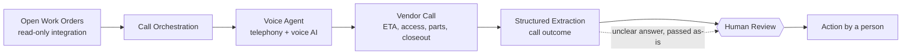

# AI Voice Agent for Facility Operations — Architecture (In development)

Conceptual view only. No real work orders, vendors, numbers, endpoints, or accounts are shown.

**Data boundary:** work orders are read only; nothing is written back.
**Control point:** every structured outcome goes to a person; an unclear answer is passed on as unclear.
**Status:** in development.
