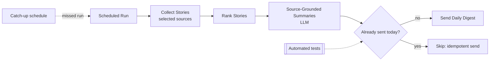

# Automated AI Daily News Digest — Architecture

Conceptual view only. No real sources, keys, recipients, or logs are shown.

**Delivery guards:** idempotent sends block a second send for the same day; catch-up scheduling re-runs a missed day; automated tests cover both.
**Grounding:** summaries are written from the source articles.
