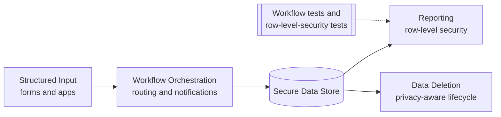

# Performance Review Platform — Architecture

Conceptual view only. No real forms, data, ratings, dashboards, or configuration are shown.

**Access control:** each role sees only its permitted records, enforced by row-level security and checked by role-by-role tests.
**Privacy:** review data has a designed deletion path.
