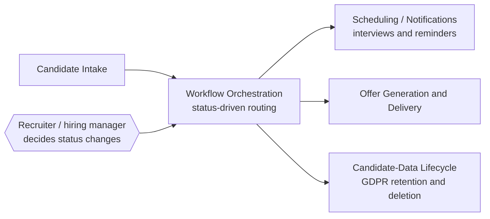

# Recruitment Operations Automation — Architecture

Conceptual view only. No real systems, identifiers, fields, or rules are shown.

**Control point:** a recruiter or hiring manager changes each status; automation runs the coordination that follows.
**Privacy:** candidate data follows defined retention and deletion rules.
